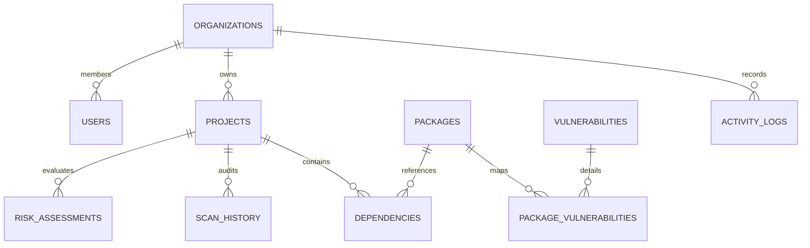

# DependencyX — Software Dependency Risk Map
> **Understand Your Dependencies. Control Your Risk.**

[](https://fastapi.tiangolo.com)
[](https://nextjs.org)
[](https://reactflow.dev)
[](https://networkx.org)
[](https://azure.microsoft.com)
[]()

DependencyX is an enterprise-grade full-stack cybersecurity web application designed to reverse-engineer, visualize, and calculate multi-project vulnerability blast radius across modern software supply chains.

---

## 1. Problem Statement & Executive Overview

Modern software development relies on deeply nested third-party packages. A vulnerability in an indirect transitive dependency (e.g. `lodash`, `axios`, `cookie`, `jsonwebtoken`) can silently compromise multiple production applications across an enterprise.

Developers and security teams traditionally lack visibility into:
- Direct vs. Transitive dependency depth.
- Cross-project vulnerability propagation.
- Single Points of Failure (SPOF).
- Organization-wide supply chain exposure.

**DependencyX** ingests real npm `package-lock.json` manifests (v1, v2, v3), constructs directed graphs using **Python NetworkX**, queries the **Google Open Source Vulnerabilities (OSV) API** in real time, executes **reverse graph propagation traversals**, and computes a context-aware **0–100 risk score** with dynamic **React Flow** visualization.

---

## 2. Five Core Feature Modules

### FEATURE 1: Project Management & Manifest Ingestion
- Multi-tenant organization scoping with Role-Based Access Control (**Admin** vs **Developer**).
- Upload and validation for `package-lock.json` files (supports npm lockfile versions 1, 2, and 3).
- Atomic relational database ingestion separating master package entities from project dependency edges.
- Complete scan audit logs and project lifecycle CRUD.

### FEATURE 2: Dependency Graph Explorer
- Built with **Python NetworkX** on the backend and **React Flow** on the frontend.
- Displays root application, direct dependencies, and multi-tier transitive dependencies.
- Automatic hierarchical coordinate layout preventing node overlap.
- Live vulnerability glow highlighting Critical, High, Medium, and Low severity nodes.
- Interactive zooming, panning, and slide-out telemetry drawer showing CVSS scores, in/out degrees, and betweenness centrality.
- **Circular Dependency Detection**: Identifies cyclic dependency loops (`A -> B -> A`) using strongly connected cycle analysis.

### FEATURE 3: Vulnerability Detection Engine
- Native integration with the **Google OSV API** (`https://api.osv.dev/v1/query`).
- Version matching for npm packages with CVE, GHSA, and OSV advisory extraction.
- Severity classification: **CRITICAL** (9.0–10.0), **HIGH** (7.0–8.9), **MEDIUM** (4.0–6.9), **LOW** (0.1–3.9).
- Patched remediation version extraction.
- Intelligent in-memory caching to eliminate rate-limiting and external API latency.
- Graceful network degradation: Never invents fake vulnerabilities and displays verifiable status.

### FEATURE 4: Risk Analysis & Reverse Propagation Engine
- **Topological Dependency Depth**: BFS shortest path calculation from root application.
- **Reverse Vulnerability Propagation**: Reverse graph traversal ($G^T$) tracing how deeply nested transitive flaws propagate upstream to production codebases.
- **Cross-Project Impact**: Identifies every application across the enterprise dependent on the compromised package.
- **Transparent 0–100 Composite Risk Formula**:
  $$\text{Risk}_{\text{project}} = \min(100, W_s \cdot S_{\text{peak}} + W_p \cdot P_{\text{avg}} + W_c \cdot C_{\text{spof}} + W_d \cdot D_{\text{max}})$$
  - Peak Severity ($W_s = 0.45$)
  - Cross-Project Propagation ($W_p = 0.25$)
  - Single Points of Failure & Centrality ($W_c = 0.15$)
  - Graph Depth Footprint ($W_d = 0.15$)
- **Single Points of Failure (SPOF)**: Automatic detection of shared, unpatched, or high-centrality dependencies.

### FEATURE 5: Security Dashboard & Compliance Analytics
- Executive dashboard displaying real database figures: Total Projects, Unique Packages, Dependencies, Vulnerable Packages, Critical Vulnerabilities, High-Risk Projects, and Org Risk.
- Recharts visualizations: Severity distribution, project risk comparison, dependency depth distribution.
- Priority remediation table for top vulnerable packages.
- Downloadable security audit reports in **CSV** and **Executive HTML** formats.

---

## 3. Academic Requirements Integration

| Academic Domain | Implementation in DependencyX | Verification File |
| :--- | :--- | :--- |
| **System Design** | Modular monolithic architecture, sequence data flows, trade-off analysis vs. microservices, graph traversal algorithms ($O(V+E)$). | [`docs/system_design.md`](file:///c:/Users/HP/OneDrive/Desktop/PBL%20project/docs/system_design.md)<br>[`docs/architecture.md`](file:///c:/Users/HP/OneDrive/Desktop/PBL%20project/docs/architecture.md) |
| **RDBMS (3NF)** | 11 relational tables in Third Normal Form (3NF), Primary & Foreign Keys, unique constraints, B-Tree indexes, database VIEWs, Stored Procedure, and ACID transactions. | [`database/schema.sql`](file:///c:/Users/HP/OneDrive/Desktop/PBL%20project/database/schema.sql)<br>[`database/queries.sql`](file:///c:/Users/HP/OneDrive/Desktop/PBL%20project/database/queries.sql)<br>[`database/er_diagram.md`](file:///c:/Users/HP/OneDrive/Desktop/PBL%20project/database/er_diagram.md) |
| **Microsoft DP-900** | Data classification matrix mapping Structured (Azure SQL), Semi-Structured (Blob Storage Hot Tier for JSON manifests), and Unstructured (Blob Storage Cool Tier for audit reports). | [`docs/data_classification.md`](file:///c:/Users/HP/OneDrive/Desktop/PBL%20project/docs/data_classification.md) |
| **Cloud Security** | Salted `bcrypt` password hashing, stateless JWT Bearer tokens, Role-Based Access Control (Admin vs Developer), STRIDE threat model, parameterized SQL queries, CORS protection, and immutable audit logs. | [`docs/threat_model.md`](file:///c:/Users/HP/OneDrive/Desktop/PBL%20project/docs/threat_model.md) |

---

## 4. Entity Relationship Diagram (11 Tables)



The relational tables implemented are:
1. `users` — User credentials, bcrypt hash, global roles (`admin`, `developer`).
2. `organizations` — Multi-tenant organization boundaries.
3. `organization_members` — User-to-organization membership junction.
4. `projects` — Tracked software applications.
5. `packages` — Master package catalog.
6. `dependencies` — Direct and transitive dependency edges with tree depth and parent pointers.
7. `vulnerabilities` — OSV / CVE / GHSA security intelligence.
8. `package_vulnerabilities` — Associative junction mapping packages to CVEs.
9. `scan_history` — Audit log of vulnerability scans.
10. `risk_assessments` — Evaluated 0–100 risk scores and factor decompositions.
11. `activity_logs` — Immutable audit trail of system operations.

---

## 5. Technology Stack

- **Frontend**: Next.js 14, React 18, TypeScript, Tailwind CSS, React Flow 11, Recharts 2, Lucide Icons.
- **Backend**: Python 3.12, FastAPI, Pydantic v2, SQLAlchemy 2.0, NetworkX 3.2, Python-Jose (JWT), Bcrypt.
- **Database**: Microsoft Azure SQL Database (Production) / SQLite (Local Zero-Config Development).
- **Cloud Storage**: Microsoft Azure Blob Storage (with Local Disk Storage Fallback).
- **External Security API**: Google OSV.dev REST API.

---

## 6. Quick Start & Setup Instructions

### Prerequisites
- Python 3.10+
- Node.js 18+ and npm

### 6.1 Backend Setup
```bash
# 1. Activate the virtual environment
.\.venv\Scripts\Activate.ps1

# 2. Verify dependencies (already installed in workspace)
pip install -r backend/requirements.txt

# 3. Seed Database with Realistic Data & Test Accounts
python -m backend.app.database.seed_data

# 4. Start FastAPI Backend Server
python -m uvicorn backend.app.main:app --host 127.0.0.1 --port 8000 --reload
```
API Documentation and interactive Swagger UI will be available at: `http://127.0.0.1:8000/docs`

### 6.2 Frontend Setup
```bash
# In a new terminal window:
cd frontend

# Start Next.js Development Server
npm.cmd run dev
```
The application web interface will be accessible at: `http://localhost:3000`

---

## 7. Pre-Configured Test Accounts (RBAC)

Use these accounts to evaluate Role-Based Access Control:

| Role | Email Address | Password | Privileges |
| :--- | :--- | :--- | :--- |
| **Security Administrator** | `admin@dependencyx.io` | `Password123!` | Full organization control, project deletion, audit log access, role elevation. |
| **Developer** | `developer@dependencyx.io` | `Password123!` | Project creation, manifest upload, vulnerability scanning, report download. |

> **Evaluator Tip**: The web interface includes a **1-Click Demo Login** button on the sign-in modal, allowing instantaneous access without manual typing.

---

## 8. Automated Test Suite Execution

Run the complete automated test suite covering authentication, parsing, NetworkX graph modeling, OSV querying, and risk calculations:

```bash
.\.venv\Scripts\python.exe -m pytest -v backend\tests
```

Expected output:
```text
backend/tests/test_api.py::test_list_and_get_projects PASSED             [  7%]
backend/tests/test_api.py::test_dependencies_and_graph PASSED            [ 14%]
backend/tests/test_api.py::test_risk_and_critical_deps PASSED            [ 21%]
backend/tests/test_api.py::test_dashboard_analytics PASSED               [ 28%]
backend/tests/test_api.py::test_reports_generation PASSED                [ 35%]
backend/tests/test_api.py::test_activity_logs PASSED                     [ 42%]
backend/tests/test_auth.py::test_password_hashing PASSED                 [ 50%]
backend/tests/test_auth.py::test_jwt_token_creation_and_decoding PASSED  [ 57%]
backend/tests/test_graph.py::test_build_project_graph_and_depths PASSED  [ 64%]
backend/tests/test_graph.py::test_circular_dependency_detection PASSED   [ 71%]
backend/tests/test_parser.py::test_parse_valid_v2_manifest PASSED        [ 78%]
backend/tests/test_parser.py::test_parse_invalid_json PASSED             [ 85%]
backend/tests/test_parser.py::test_parse_missing_package_structure PASSED [ 92%]
backend/tests/test_risk.py::test_risk_calculation_seeded_project PASSED  [100%]
============================= 14 passed in 3.36s ==============================
```

---

## 9. Included Realistic Sample Manifests

Test upload and real-time OSV scanning using the pre-packaged manifests:
- `backend/samples/sample_vulnerable_lock.json`: Contains real unpatched vulnerabilities (`lodash@4.17.15`, `axios@0.21.1`, `jsonwebtoken@8.5.1`, `cookie@0.3.1`).
- `backend/samples/sample_secure_lock.json`: Modern secure manifest with patched packages.

---

## 10. Credits & Assistance
- Vulnerability Database: [Google Open Source Vulnerabilities (OSV.dev)](https://osv.dev)
- Graph Theory Engine: [Python NetworkX](https://networkx.org)
- Interactive Graph Visualizer: [React Flow](https://reactflow.dev)
- Iconography: [Lucide Icons](https://lucide.dev)
