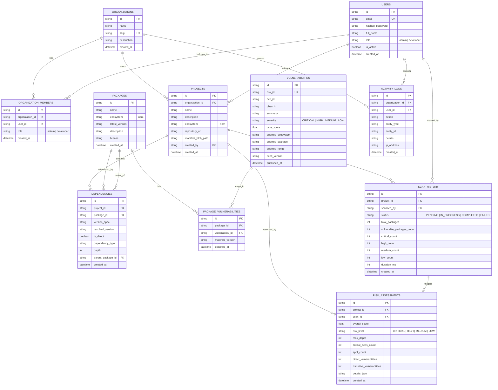

# DependencyX — Entity Relationship Diagram & RDBMS Normalization Guide

## 1. Relational Database Architecture Overview

DependencyX implements an enterprise-grade Relational Database Management System (RDBMS) schema designed in **Third Normal Form (3NF)** to ensure zero data redundancy, transactional integrity, and compliance with Microsoft Azure SQL Database standards.

---

## 2. Normalization Verification (1NF to 3NF)

### First Normal Form (1NF) Compliance
- **Atomic Values**: Every attribute in every table stores atomic, non-decomposable values. No repeating groups or comma-separated lists exist for dependencies or vulnerabilities.
- **Unique Identification**: Every table possesses a clear Primary Key (`id`), enforcing unique row identification.
- **Predictable Types**: Well-defined column types (e.g., `NVARCHAR`, `DATETIME2`, `INT`, `FLOAT`, `BIT`).

### Second Normal Form (2NF) Compliance
- Meets all criteria of 1NF.
- **No Partial Dependencies**: In tables with composite business keys (e.g. `organization_members(organization_id, user_id)` or `package_vulnerabilities(package_id, vulnerability_id, matched_version)`), every non-key attribute is fully functionally dependent on the primary key, eliminating partial functional dependencies.

### Third Normal Form (3NF) Compliance
- Meets all criteria of 2NF.
- **No Transitive Dependencies**: Non-prime attributes are non-transitively dependent on primary keys ($X \to Y \to Z$ is eliminated).
  - Package metadata (e.g. `description`, `license`) is stored once in `PACKAGES`, not duplicated across each `DEPENDENCY` row.
  - Vulnerability details (e.g. `cvss_score`, `severity`, `summary`) are stored in `VULNERABILITIES`, mapped to packages through the associative junction entity `PACKAGE_VULNERABILITIES`.
  - Organization data is separate from `USERS` and mapped via `ORGANIZATION_MEMBERS`, ensuring multi-tenancy and data isolation without duplicating organization details.

---

## 3. RDBMS Advanced Features Implemented

1. **Database Views**:
   - `dbo.v_project_risk_summary`: Combines projects, latest scan statistics, and evaluated risk score for instant dashboard queries without multi-query overhead.
   - `dbo.v_vulnerable_dependencies`: Pre-joined view linking projects, packages, dependencies, and OSV security alerts.
2. **Stored Procedures**:
   - `dbo.sp_calculate_project_risk_metrics`: Computes direct vs. transitive counts, max depth, and vulnerability counts server-side inside Azure SQL.
3. **Transactions (ACID)**:
   - Manifest upload and dependency tree extraction run within an atomic transaction. If parsing fails midway, all changes are rolled back.
4. **Targeted Indexes**:
   - B-tree non-clustered indexes on `dependencies(project_id)`, `dependencies(package_id)`, `packages(name)`, `vulnerabilities(osv_id)`, and `scan_history(project_id)`.
